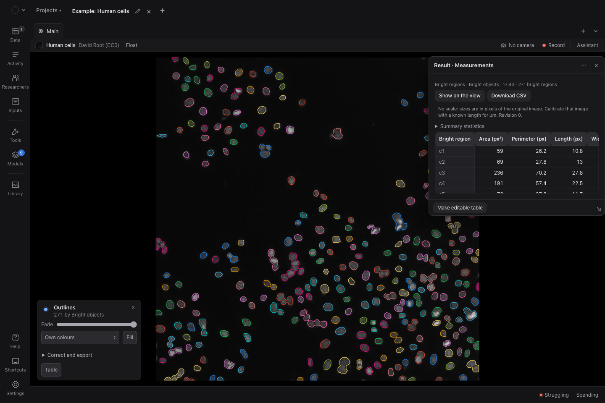

# HookeUI

**An open-source workspace for scientific imaging—on your own computer.**

Open images and video, connect a microscope camera, inspect scientific arrays,
measure regions, and run analysis tools in one workspace. Save your inputs and
results in Projects so you can return to your work.

HookeUI runs locally and **requires no Hooke account**.

[Download Stable](https://github.com/wpulier/hookeui.org/releases/latest) ·
[Download Beta](https://github.com/wpulier/hookeui-beta/releases/latest) ·
[Community](https://hookeui.discourse.group) ·
[Contribute](#contribute)



*The built-in microscopy example, with bright-region outlines and pixel measurements.
Image: David Root, [CC0](assets/examples/NOTICE.md). [Capture details](docs/images/README.md).*

## What you can do

- **Explore your images.** Work with pictures, recordings, scientific arrays and
  supported live camera sources. Start with a file; a microscope is optional.
- **Measure and annotate.** Inspect regions, work with masks and labels, and retain
  measurements alongside their source data.
- **Choose your analysis tools.** Use the model and method catalog for workflows
  such as segmentation, image processing and measurement, including Fiji adapters.
- **Keep work organized.** Save Projects, revisit inputs and results, and build on
  earlier work.
- **Use optional AI assistance.** Configure supported providers and models for
  your workflow. Model downloads, API credentials and provider costs are separate;
  external providers may receive the data you choose to send.

Available methods depend on their installation and input requirements. The app's
Models page shows what each method needs.

## Download the Mac app

**Apple Silicon Mac · macOS 14 or later.** Official downloads are signed and notarized.

| Channel | Choose it for | Download |
| --- | --- | --- |
| **Stable** | The recommended release for regular use | [Download Stable and read release notes](https://github.com/wpulier/hookeui.org/releases/latest) |
| **Beta** | Newer features for testing and feedback | [Download Beta and read release notes](https://github.com/wpulier/hookeui-beta/releases/latest) |

1. Open a release page above and download its **`.dmg`** asset.
2. Open the disk image and drag **HookeUI** or **HookeUI Beta** into **Applications**.
3. Launch it from Applications and follow the first-run setup. An internet
   connection is needed to download the runtime dependencies.

Each app receives updates through its own channel. Beta and Stable can be installed
side by side and keep separate workspaces; Beta does not automatically open or
migrate your Stable data. Copy or import work deliberately when testing.

The download repositories host installers and update feeds. **This repository is
where application development happens.** See the [desktop guide](packaging/macos/README.md)
for installation details and channel behavior.

## Run from source

The supported development setup is **macOS on Apple Silicon**, with Xcode Command
Line Tools, FFmpeg, `uv`, and a supported Node.js version. Start with the
[setup guide](docs/clean-start.md) for prerequisites and troubleshooting.

```sh
git clone --branch dev https://github.com/wpulier/HookeUI.git
cd HookeUI
make setup
make start
```

Open the Studio URL printed in the terminal. Start with a picture or the
[generated example](examples/three-particles/README.md); no camera or cloud account
is needed. Keep the terminal open while working. `make stop` stops this checkout's
servers, and `make status` reports their state.

## Contribute

Bug reports, documentation, examples, analysis methods and code contributions are
welcome. [Ask the community](https://hookeui.discourse.group) about a workflow, or
[open an issue](https://github.com/wpulier/HookeUI/issues) with a reproducible problem.

**Open pull requests against `dev`.** It is the default branch and the home for
ongoing development.

1. Fork the repository and create a focused branch from `dev`.
2. Make your change and run the relevant checks. `make check-public` is a useful
   starting point: it uses generated inputs without private recordings or accounts.
3. Sign off your commits with `git commit -s`, following the
   [Developer Certificate of Origin](docs/contributing/DCO.txt).
4. Submit a PR to **`wpulier/HookeUI:dev`** describing the change, how you checked it,
   and any known limitations. Maintainers review and merge contributions.

| Branch | Purpose | Merge authority |
| --- | --- | --- |
| `dev` | Development and the source for Beta releases | Maintainers, through reviewed PRs |
| `main` | Accepted source for Stable releases | Repository owner, through a promotion PR |

**PR → `dev` → publish Beta → Will accepts → promote to `main` → publish Stable.**

Only appointed maintainers' reviews count toward the required approval for `dev`;
only Will can promote to `main`. Both branches are open source. Releases are
explicit: a merge or tag alone does not ship an update. See the
[review rules](CONTRIBUTING.md#reviews-and-maintainer-access) and
[release policy](packaging/macos/RELEASING.md).

Read [CONTRIBUTING.md](CONTRIBUTING.md), the [contributor checks](docs/testing/public-contributor-check.md),
and the [capability guide](docs/contributing/README.md) before starting. The complete
integration gate is `make check`; its additional prerequisites are documented in
the testing guide. Report security issues through the [security policy](SECURITY.md).

## Learn more

- [Website, lessons and showcases](https://hookeui.org)
- [Community discussions](https://hookeui.discourse.group)
- [Core architecture and optional extensions](docs/CORE-BOUNDARY.md)
- [Release process](packaging/macos/RELEASING.md)
- [Code of conduct](CODE_OF_CONDUCT.md)

## License

First-party code is licensed under **[Apache-2.0](LICENSE)**, with
[third-party notices and exceptions](THIRD_PARTY.md). Models, datasets and optional
services retain their own terms. See [component terms](docs/licences.md) and the
[media inventory](MEDIA.json).

The official Hooke brand, website and hosted platform are maintained separately.
The code license does not grant rights to the [Hooke trademarks](TRADEMARKS.md).
